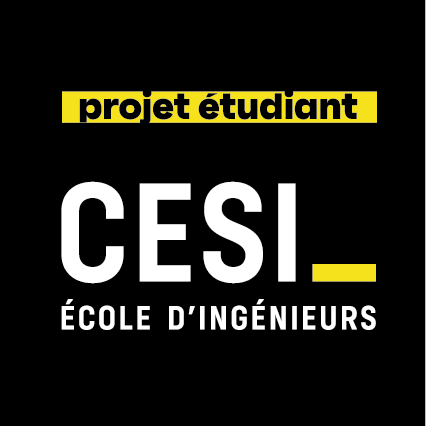

<div align="center">



# Leyenda (Legenda) — Pipeline IA de Traitement d'Images & Génération Automatique de Légendes

**Projet Machine Learning & Deep Learning — CESI**  
*Entreprise commanditaire fictive : **TouNum** (numérisation et indexation intelligente de documents)*

**Membres du groupe :**  
Schadrac APOUPOH · Daryl BOULOU · William PANCHA · Jaad CHOKR

</div>

---

## 1. Contexte et objectif du projet

L'entreprise **TouNum**, spécialisée dans la numérisation de supports papier, souhaite automatiser l'analyse et l'indexation de grands volumes de documents numérisés grâce au Deep Learning. L'objectif final est de **générer automatiquement une légende descriptive (*image captioning*)** pour chaque photographie issue de la chaîne de numérisation.

Or, les lots de documents scannés contiennent à la fois des photographies, des textes, des schémas techniques, des croquis et des peintures, et subissent des dégradations liées à la numérisation (grain du papier, bruit capteur, artefacts de compression).

Ce projet met donc en place une **chaîne complète de traitement en 3 livrables scientifiques** ainsi qu'une **application web interactive** :

```
[Document numérisé]
        │
        ▼
┌──────────────────────────────────────────────────────────┐
│ Livrable 1 : Classification Photo / Non-photo (CNN)      │
│  → Écarte les textes, schémas, croquis et peintures      │
└──────────────────────────────────────────────────────────┘
        │ (Si P(Photo) ≥ 0.2301)
        ▼
┌──────────────────────────────────────────────────────────┐
│ Livrable 2 : Débruitage photographique (U-Net MSE+SSIM)  │
│  → Supprime le bruit de numérisation tout en préservant  │
│    les contours et textures fines                        │
└──────────────────────────────────────────────────────────┘
        │
        ▼
┌──────────────────────────────────────────────────────────┐
│ Livrable 3 : Image Captioning (InceptionV3 + Bahdanau    │
│              Attention + Décodeur LSTM)                  │
│  → Génère automatiquement la légende descriptive         │
└──────────────────────────────────────────────────────────┘
```

---

## 2. Détail des 3 Livrables (Notebooks)

### Livrable 1 — Classification binaire Photo / Non-photo (`Livrable 1.ipynb`)
- **Objectif :** Isoler automatiquement les photographies parmi 5 catégories de documents : `Painting`, `Photo`, `Schematics`, `Sketch` et `Text`.
- **Prétraitement :** Vérification et nettoyage des fichiers corrompus, redimensionnement en $128 \times 128$ RGB, découpage reproductible en **70 % entraînement / 15 % validation / 15 % test**.
- **Architecture retenue (`model_full`) :** Réseau de neurones convolutif (CNN) séquentiel comprenant une couche `Rescaling(1./255)`, 3 blocs `Conv2D` (32, 64 et 128 filtres $3 \times 3$, activation ReLU) suivis de `MaxPooling2D(2, 2)`, une régularisation **ElasticNet (L1/L2)** sur les couches profondes, une couche `Dense(128, relu)` et une sortie `Dense(5, softmax)`.
- **Décision binaire et résultats :**
  - Le modèle prédit les probabilités des 5 classes (**Accuracy multiclasses : 90,80 %** sur 6 275 images de test).
  - En regroupant en *Photo* vs *Non-photo* : **Accuracy binaire de 93,04 %** et **AUC-ROC de 0,9758**.
  - Détermination du **seuil optimal de Youden ($\theta = 0,2301$)** maximisant $TPR - FPR$, permettant d'atteindre un **rappel Photo de 93,94 %** pour seulement **8,79 %** de faux positifs.
- **Modèle exporté :** [`models/model_full.weights.h5`](models/model_full.weights.h5).

---

### Livrable 2 — Débruitage de photographies par Auto-Encodeur & U-Net (`Livrable 2.ipynb`)
- **Objectif :** Nettoyer le bruit présent sur les photographies retenues à l'étape 1 sans flouter les détails nécessaires à la compréhension de la scène.
- **Données et augmentation :** 148 photographies de référence recadrées au centre en $256 \times 256$ (70 % train / 15 % val / 15 % test). Extraction de **16 patchs aléatoires de $128 \times 128$** par image d'entraînement avec retournement horizontal aléatoire (~1 648 patchs d'entraînement) et ajout d'un bruit gaussien contrôlé.
- **Modèles comparés :**
  1. **Auto-encodeur convolutif simple** entraîné avec la perte **MSE**.
  2. **Architecture U-Net entièrement convolutive** intégrant des **skip connections** (concaténation encodeur/décodeur), des couches `Conv2DTranspose` et `BatchNormalization`, entraînée avec une **loss combinée $\text{MSE} + \text{SSIM}$**.
- **Résultats :** L'architecture U-Net associée à la perte $\text{MSE} + \text{SSIM}$ surpasse nettement l'auto-encodeur classique sur les métriques **PSNR** et **SSIM**, en supprimant l'effet de flou et en préservant les textures fines (feuillages, contours, visages).
- **Modèle exporté :** [`models/unet_denoiser_livrable2.keras`](models/unet_denoiser_livrable2.keras).

---

### Livrable 3 — Annotation automatique des photographies (`Livrable 3.ipynb`)
- **Objectif :** Générer une légende textuelle décrivant le contenu visuel de chaque photographie débruitée.
- **Pipeline de préparation sur MS-COCO (`train2014`) :**
  1. Filtrage des images via le classifieur du Livrable 1 ($\theta = 0,2301$).
  2. Débruitage des photos retenues en $299 \times 299$ via le U-Net du Livrable 2 (avec padding symétrique multiple de 4).
  3. Extraction des caractéristiques visuelles via **InceptionV3** (pré-entraîné sur ImageNet, sans tête de classification), produisant pour chaque image une grille spatiale de $8 \times 8 \times 2048$ remodelée en **$(64, 2048)$** (64 régions d'intérêt décrites par 2 048 caractéristiques).
  4. Tokenisation des légendes (`captions_train2014.json`) encadrées par `<start>` et `<end>`, limitée aux **5 000 mots les plus fréquents** (`VOCAB_SIZE = 5001` avec `<pad>`, longueur maximale `max_length = 52`).
- **Modélisation et comparaison GRU vs LSTM :**
  - Architecture **Encodeur-Décodeur avec Attention de Bahdanau** :
    - `CNN_Encoder` : projette les features $(64, 2048)$ dans un espace d'embedding de dimension `256`.
    - `BahdanauAttention` : calcule à chaque pas de temps les poids d'attention sur les 64 zones de l'image.
    - `AttentionDecoder` (`units = 512`) : comparé avec une cellule récurrente **GRU** et une cellule **LSTM**.
  - **Évaluation quantitative (20 époques) :**

    | Métrique | Modèle GRU | Modèle LSTM |
    | :--- | :---: | :---: |
    | **Perte de validation minimale** | 2,406 | **2,391** |
    | **Précision sur le mot suivant (val)** | 48,6 % | **48,9 %** |
    | **Score BLEU** | 0,052 | **0,064** |
    | **Score CIDEr** | 0,728 | **0,750** |

  - Le décodeur **LSTM** obtenant les meilleurs scores **CIDEr (0,750)** et **BLEU** est retenu pour la production, accompagné d'une visualisation des cartes d'attention mot par mot sur l'image.
- **Artéfacts exportés :**
  - [`models/encoder_LSTM_epoch_019.weights.h5`](models/encoder_LSTM_epoch_019.weights.h5)
  - [`models/decoder_LSTM_epoch_019.weights.h5`](models/decoder_LSTM_epoch_019.weights.h5)
  - [`models/tokenizer.json`](models/tokenizer.json)

---

## 3. Structure du dépôt

```text
Leyenda/
├── Livrable 1.ipynb                        # Notebook Livrable 1 : Classification Photo / Non-photo
├── Livrable 2.ipynb                        # Notebook Livrable 2 : Débruitage Auto-encodeur & U-Net
├── Livrable 3.ipynb                        # Notebook Livrable 3 : Image Captioning (GRU vs LSTM + Attention)
├── models/                                 # Poids entraînés et tokenizer utilisés en production
│   ├── model_full.weights.h5               # Classifieur CNN (Livrable 1)
│   ├── unet_denoiser_livrable2.keras       # Modèle de débruitage U-Net (Livrable 2)
│   ├── encoder_LSTM_epoch_019.weights.h5   # Encodeur CNN de captioning (Livrable 3)
│   ├── decoder_LSTM_epoch_019.weights.h5   # Décodeur LSTM à attention de Bahdanau (Livrable 3)
│   └── tokenizer.json                      # Tokenizer entraîné sur les légendes COCO (5 001 tokens)
├── web_app/                                # Application web Flask (Legenda)
│   ├── app.py                              # Serveur Flask & routes API (/api/predict, /api/predict-stream)
│   ├── utils.py                            # Pipeline d'inférence complet (exécuté sur CPU)
│   ├── requirements.txt                    # Dépendances Python de l'application web
│   ├── templates/
│   │   └── index.html                      # Interface utilisateur avec suivi temps réel du pipeline
│   └── README.md                           # Documentation dédiée à l'application web
├── Dockerfile                              # Configuration de conteneurisation pour le déploiement Cloud
├── .dockerignore                           # Fichiers exclus du contexte de build Docker
├── .gitignore                              # Fichiers exclus du suivi Git
└── README.md                               # Documentation générale du projet
```

*(Note : Les dossiers `datasets/` et `checkpoints/` générés localement lors de l'entraînement des notebooks sont ignorés par Git et Docker afin d'alléger le dépôt).*

---

## 4. Application Web (`web_app/`) et Déploiement

Une interface web complète (**Legenda**), située dans le dossier [`web_app/`](web_app/), permet d'importer une image (JPG, PNG, WEBP) par glisser-déposer et de visualiser en temps réel chaque étape du pipeline (Classification $\rightarrow$ Débruitage $\rightarrow$ Génération de la légende) grâce à un flux HTTP en streaming (`NDJSON`).

### Lancement rapide en local
```bash
pip install -r web_app/requirements.txt
python web_app/app.py
```
Puis ouvrir `http://127.0.0.1:5000`.

### Lancement via Docker (Production / Cloud)
L'application est conteneurisée via le [`Dockerfile`](Dockerfile) à la racine et configurée pour exécuter toute l'inférence sur **CPU** (`PyTorch CPU` + `Keras 3` + `Gunicorn`) :
```bash
docker build -t leyenda .
docker run -p 7860:7860 leyenda
```
Puis ouvrir `http://localhost:7860`.

👉 Pour plus de détails techniques sur l'API et la configuration du serveur, consulter [`web_app/README.md`](web_app/README.md).
